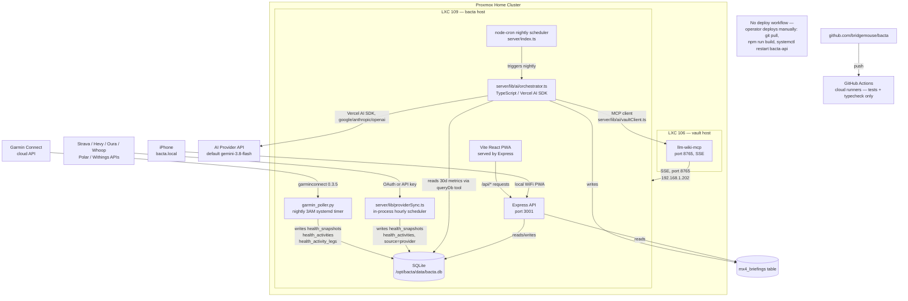

# Bacta — System Architecture

> The native Android client (`android/`) is documented in `docs/ANDROID.md` (rules, layers, verification, device workflow); this file covers the server and the web client.

## System Diagram



---

## Stack

Verified against `package.json` (not CLAUDE.md).

| Layer | Technology | Version |
|---|---|---|
| Frontend | React | 19.2 |
| Frontend | TypeScript | 6.0 |
| Frontend | Vite | 8.0 |
| Frontend | React Router | 7.16 |
| Backend | Express | 5.2 |
| Backend | TypeScript (tsx) | 4.21 |
| Database | SQLite via better-sqlite3 | 12.9 |
| Testing | Vitest | 4.1 |
| Testing | Testing Library (React) | 16.3 |
| CI | GitHub Actions, cloud runners (tests + typecheck only, no deploy workflow) | — |
| Python | garminconnect | 0.3.5 |
| MX-4 | Vercel AI SDK (TypeScript), provider-agnostic (google/anthropic/openai) | — |

Note: `@tailwindcss/vite` is installed as a dev dependency and `@import "tailwindcss"` appears in `client/index.css`. However, **no Tailwind utility classes are used in any component** — all component styles are inline. Tailwind's global reset/base layer is applied but the utility system is not used in this project.

---

## App Shell Model

The app is a fixed iOS-style viewport. There is no page scroll — only the content zone scrolls.

```
<html> / <body> — position: fixed; overflow: hidden
└── #root (position: fixed; inset: 0)
    └── <AppShell section={...}>
        ├── <TopBar />          — ~52px, fixed at top
        │   (home mode) BACTA·OS + idle MX4Sigil + MX-4 ONLINE indicator
        │   (section mode) back chevron + section Sigil + channel label
        ├── content zone        — flex: 1; overflow-y: auto; padding: 13px 13px 20px
        │   (section pages render here)
        ├── <BottomBar />       — fixed at bottom, always MX-4 cyan
        │   left: Ask MX-4 circle (listen sigil, breathing glow)
        │   center: Overview/Trends toggle (built sections only)
        │   right: Nav circle (hex menu icon)
        ├── <BottomSheet />     — NavSheet (All Systems), slides up
        └── <AskSheet />        — Ask MX-4 sheet, slides up
```

The background texture (`bactaTexture`) covers the full viewport with section-accented scanlines. The content zone is the only scrollable region. `position: fixed; overflow: hidden` on the outer shell is why Playwright `fullPage` screenshots only capture the viewport — use `browser_evaluate` to set `scrollTop` before screenshotting scrolled content.

---

## Component Tree

Verified against the actual filesystem (`client/src/`).

Not exhaustive — this is the load-bearing structure. Grep `client/src/` for anything not listed here.

```
client/src/
├── theme.ts                          Design tokens — authoritative source
├── main.tsx                          React entry point
├── App.tsx                           React Router routes
├── declarations.d.ts                 Module type declarations
│
├── lib/
│   ├── hexA.ts                       hexA(hex, alpha) → rgba string
│   ├── bactaTexture.ts               bactaTexture(accent) → scanline/grid CSS background
│   ├── TabContext.ts                 Overview/Trends tab state context
│   ├── InfoCardContext.tsx           InfoCard overlay context (metric explanations)
│   ├── AskSheetContext.ts            Lets deep components open AskSheet without prop drilling
│   ├── ToastContext.tsx              Toast notification queue (sync/AI-provider failure surfacing)
│   ├── sectionDataCache.ts           In-memory cache for pop-in-free section navigation
│   ├── garminApi.ts                  Client-side Garmin API fetch helpers
│   ├── nutritionApi.ts               Client-side Nutrition API fetch helpers
│   ├── nutritionDate.ts              Nutrition meal/date formatting helpers
│   ├── barcodeScan.ts / imageCapture.ts  Nutrition food-entry camera helpers
│   └── stubData.ts                   Static stub data — BRIEFS (MX-4 text) fallback only
│
├── components/
│   ├── AppShell.tsx                  Fixed iOS viewport shell
│   ├── TopBar.tsx                    BactaStatusBar (home + section variants)
│   ├── BottomBar.tsx                 BactaDock (Ask + toggle + nav)
│   ├── BottomSheet.tsx               NavSheet (All Systems slide-up)
│   ├── AskSheet.tsx                  Ask MX-4 slide-up sheet
│   ├── Sheet.tsx                     Animated bottom-sheet wrapper primitive; manages focus + inert background
│   ├── AuthGate.tsx                  PIN-gated app shell wrapper (session cookie check)
│   ├── ErrorBoundary.tsx             Catches render crashes, reports to POST /api/logs
│   ├── ToastContainer.tsx            Renders the ToastContext queue
│   ├── ProviderCard.tsx              Multi-device provider connect/sync card (Settings)
│   ├── SecurityRail.tsx              PIN set/change UI (Settings)
│   ├── MX4Card.tsx                   TransmissionPanel + MX4Briefing (deprecated MX4Card stub removed)
│   ├── MetricTile.tsx                SystemCard + MetricTile (Home grid)
│   └── SectionShell.tsx              Calibrating skeleton for unbuilt sections (Blood Work, Daily Log only)
│
├── components/primitives/
│   ├── MX4Sigil.tsx                  6-mood aperture sigil (transmit/idle/listen/think/alert/pleased)
│   ├── Sigil.tsx                     Per-section geometric line glyph icons
│   ├── NavIcon.tsx                   Hexagonal menu icon
│   ├── Ring.tsx                      Circular progress ring (SVG)
│   ├── Sparkline.tsx                 Area sparkline (SVG)
│   ├── StatusCore.tsx                Breathing status dot with ping ring
│   ├── ReadinessDots.tsx             1–5 dot readiness indicator
│   ├── Bracket.tsx                   Four-corner console bracket ticks
│   ├── FadeValue.tsx                 Crossfade primitive for metric-value refresh
│   └── FTelemetry.tsx                Animated telemetry bar graph
│
├── components/viz/
│   ├── Bars7.tsx                     7-bar chart, today highlighted
│   ├── Delta.tsx                     ▲/▼ change badge with lowerBetter support
│   ├── Gauge.tsx                     270° arc gauge with centered value
│   ├── HeadlineCard.tsx              Two-up headliner metric card shell
│   ├── HealthStatusTile.tsx          Overnight vitals tile with StatusCore badge (direction-neutral "Flagged" label)
│   ├── HRVRangeBadge.tsx             IN RANGE / baseline badge for HRV
│   ├── IntensityBar.tsx              Stacked moderate/vigorous intensity bar
│   ├── LoadBand.tsx                  Horizontal load band with optimal zone
│   ├── LogEntry.tsx                  Activity log line (expandable — Training Effect, HR zones, run dynamics, multi-sport legs)
│   ├── Rail.tsx                      Section divider rail with accent label
│   ├── SleepDepth.tsx                Topographic sleep depth area chart (SVG)
│   ├── StageDistribution.tsx         Sleep stage bar + breakdown rows + footer
│   ├── StatusBanner.tsx              Training status hero panel
│   ├── TrendRow.tsx                  Trends-tab row: label/value/delta + sparkline
│   ├── VitalTile.tsx                 Compact secondary metric tile with sparkline
│   └── ZoneDistribution.tsx          HR zone vertical list with bars + summary footer
│
├── hooks/
│   ├── useHomeData.ts                Home SystemCard live data
│   ├── useRecoveryData.ts            Recovery live data (HRV, battery, vitals, source badges)
│   ├── useSleepData.ts               Sleep live data (stages, score, SpO2, source badges)
│   ├── useTrainingData.ts            Training live data (status, zones, activities)
│   ├── useNutritionSummary.ts        Nutrition daily targets + macro totals
│   ├── useNutritionLog.ts            Nutrition food-log CRUD
│   ├── useSyncState.ts               Sync button state (polling /api/garmin/sync/status)
│   ├── useBriefing.ts                MX-4 briefing fetch per section
│   ├── useChat.ts                    Ask MX-4 session state + SSE streaming
│   ├── useLogs.ts                    In-app diagnostic log viewer (Settings → Diagnostics)
│   └── useAppLogo.ts                 Dynamic PWA logo/manifest selection
│
└── pages/
    ├── HomePage.tsx                  Overview: MX4Briefing + SystemCard grid; Trends: cross-channel
    ├── RecoveryPage.tsx              Overview: gauge + HRV + vitals; Trends: 6 metric rows
    ├── SleepPage.tsx                 Overview: depth field + stages; Trends: duration + score
    ├── TrainingPage.tsx              Overview: status + zones + log; Trends: intensity + load
    ├── NutritionPage.tsx             Live — renders nutrition/NutritionOverview.tsx + NutritionLibrary.tsx
    ├── nutrition/
    │   ├── NutritionOverview.tsx     Daily targets, macro totals, meal-grouped log
    │   ├── NutritionLibrary.tsx      Food/recipe search, creation, variant management
    │   ├── LogEntrySheet.tsx         Add a food/recipe to today's log
    │   ├── EditEntrySheet.tsx        Edit a logged entry (variant, quantity, ad-hoc macros)
    │   └── TargetsSheet.tsx          Edit daily macro targets
    ├── SettingsPage.tsx              MX-4 intelligence, vault, providers, security, diagnostics
    ├── LogsPage.tsx                  Full-screen app_logs viewer (Settings → Diagnostics → Logs)
    ├── BloodWorkPage.tsx             SectionShell (calibrating — waiting on lab results)
    └── DailyLogPage.tsx              SectionShell (calibrating — no data source defined)
```

---

## Express API Routes

All routes are defined in `server/api/` and mounted in `server/index.ts`, behind
`helmet` (CSP), a 1MB JSON limit, and rate limiting on the AI/poll endpoints.

**Auth layer:** a `requireAuth` gate fronts every data/AI/settings route (health +
`/api/auth/*` are exempt). It enforces a session cookie once a PIN is configured
(`server/lib/auth.ts`: scrypt-hashed PIN → HMAC token). `/api/auth/{status,login,logout,set-pin}`.
**MX-4 tools:** the orchestrator and chat share one tool set — `queryDb` (read-only),
`research` (OpenAlex + optional web), the wiki tools, and vault tools when enabled
(`server/lib/ai/{tools,research,vaultClient}.ts`). See `docs/MX4_REFERENCE.md`.

| Method | Path | Purpose |
|---|---|---|
| `GET` | `/api/health` | Health check — returns `{ status: 'ok', timestamp }` (exempt from auth) |
| `GET` | `/api/version` | Server version + minimum supported Android app version. **No auth** — the app calls it before login |
| `POST` | `/api/auth/login` | Exchange PIN for a session cookie (rate-limited) |
| `GET` | `/api/garmin/summary` | Latest available value per metric (uses per-metric MAX(date)) |
| `GET` | `/api/garmin/sources` | `{metric: source}` map — for multi-device source badges |
| `GET` | `/api/garmin/activities?days=7` | Last N days of activities (max 30), newest first |
| `GET` | `/api/garmin/sync/status` | Current sync state: `idle \| running \| done \| error` |
| `POST` | `/api/garmin/sync` | Spawn garmin_poller.py; returns 202 immediately |
| `GET` | `/api/garmin/weekly-volume?weeks=6` | Weekly training volume in hours |
| `GET` | `/api/garmin/weekly-intensity` | Current Garmin-week mod+vig intensity minutes |
| `GET` | `/api/garmin/weekly-avg-hr?weeks=6` | Weekly average HR from activities |
| `GET` | `/api/garmin/activities/:id/legs` | Leg data for multi-sport activity |
| `GET` | `/api/garmin/:metric?from=&to=` | Single metric — today's value, or date range if both params given |
| `GET` | `/api/insights/:section` | Insight for section — reads from `mx4_briefings` DB table, falls back to stub JSON |
| `GET`/`POST` | `/api/manual` | Manual daily inputs (readiness, caffeine, supplements) |
| `GET` | `/api/bloodwork` | Blood work markers |
| `POST` | `/api/poll/force` | Trigger a manual Garmin poll (spawns `garmin_poller.py` directly) |
| `GET`/`POST`/`PUT`/`DELETE` | `/api/nutrition/foods`, `/foods/:id`, `/foods/:id/variants`, `/food_variants/:id` | Food + variant search, creation, deletion |
| `GET` | `/api/nutrition/foods/barcode/:code` | Barcode lookup |
| `POST` | `/api/nutrition/scan/meal-photo` | Meal-photo capture → food suggestions (AI-rate-limited) |
| `GET`/`POST`/`PUT`/`DELETE` | `/api/nutrition/log`, `/log/:id` | Food-log CRUD; `/log/recent` for recents UI |
| `GET`/`POST` | `/api/nutrition/targets` | Daily macro targets |
| `GET` | `/api/nutrition/summary`, `/trend` | Daily macro totals; zero-filled trend series |
| `GET`/`POST`/`PUT`/`DELETE` | `/api/nutrition/recipes`, `/recipes/:id` | Recipe CRUD |
| `GET` | `/api/integrations/status`, `/:provider/status` | Multi-device connection status (6 providers + Garmin) |
| `GET` | `/api/integrations/:provider/authorize` | Start OAuth flow |
| `GET` | `/api/integrations/:provider/callback` | OAuth callback — registered **without** `requireAuth` (state-token CSRF protection instead) |
| `POST` | `/api/integrations/:provider/disconnect`, `/:provider/sync` | Disconnect; manual sync trigger (accepts internal token or session cookie) |
| `GET` | `/api/settings` | Current settings (API keys masked) |
| `PUT` | `/api/settings/:key` | Update one setting (encrypts secrets at write) |
| `POST` | `/api/settings/test-connection`, `/test-vault-connection`, `/restart` | AI-provider test, vault test, service restart |
| `GET` | `/api/settings/models` | Models each provider offers (`SUPPORTED_MODELS`); the Settings pickers' only source |
| `GET` | `/api/settings/custom-skills` | User-defined AskSheet quick-prompt skills |
| `POST`/`GET` | `/api/logs`, `/api/logs/sources` | App-level diagnostic log write (ErrorBoundary, client failures) + viewer feed |
| `POST` | `/api/mx4/run`, `/run/:section` | Trigger full or per-section MX-4 orchestrator run (409 if already running) |
| `GET` | `/api/mx4/run/:section/status` | Poll run status |
| `GET`/`POST`/`DELETE` | `/api/mx4/chat/:sessionId`, `/chat` | Chat history, SSE streaming send, clear history |
| `POST` | `/api/mx4/chat/seed` | Seed an assistant message (FULL ANALYSIS flow) |
| `DELETE` | `/api/mx4/wiki/patterns`, `/wiki/all` | Data-management clear actions (Settings) |

**Route ordering note:** Specific routes (`/activities`, `/sync/status`, `/weekly-volume`, `/weekly-intensity`, `/weekly-avg-hr`, and the equivalent specific routes in `nutrition.ts`/`integrations.ts`) must be defined **before** any `/:param` wildcard in the same router, or Express swallows them. This is a documented bug class in this codebase.

**Briefing pipeline:** The TypeScript orchestrator (`server/lib/ai/orchestrator.ts`) writes structured briefings to the `mx4_briefings` DB table. `insights.ts` reads from that table and returns the `content_json` field, falling back to stub JSON when no briefing exists. All four sections (home, recovery, sleep, training) produce live briefings on each orchestrator run.

---

## Data Flow

### Garmin Metrics

```
Garmin Connect API
    ↓ (garminconnect 0.3.5, authenticated via ~/.garminconnect)
scripts/garmin_poller.py
    ↓ nightly 3AM via bacta-garmin.timer (systemd)
    ↓ or triggered directly by POST /api/poll/force (spawns the poller process)
SQLite health_snapshots (EAV: date, metric, value, unit, source, source_json)
SQLite health_activities (one row per activity)
SQLite health_activity_legs (one row per leg of multi-sport activities)
    ↓
Express /api/garmin/*
    ↓
React hooks (useRecoveryData, useSleepData, useTrainingData, useHomeData)
    ↓
Section pages → viz components
```

The same `health_snapshots`/`health_activities` tables also receive rows from the 6
non-Garmin providers (Strava, Hevy, Oura, Whoop, Polar, Withings) via
`server/lib/providerSync.ts`, an in-process hourly scheduler — `source` distinguishes
which provider wrote a given row.

### MX-4 Intelligence

```
SQLite (30-day window, queried via the queryDb tool)
llm-wiki-mcp (remote MCP server on LXC 106, via server/lib/ai/vaultClient.ts)
    ↓
server/lib/ai/orchestrator.ts
    ↓ generateText (all tools: queryDb, research, wiki, vault) → generateObject (structured briefing)
    ↓ system prompt: mx4/system-prompt.md + mx4/mx4_personal_identity_record.md
    ↓                + docs/MX4_REFERENCE.md + docs/MX4_DROID_VOICE.md (all injected every run)
    ↓ sections: server/lib/ai/sections.ts
AI Provider API (Vercel AI SDK — google/anthropic/openai, default gemini-3.8-flash)
    ↓
SQLite mx4_briefings table   ← {tone, headline, summary, body, recommendation, flags} per section
    ↓
Express /api/insights/:section
    ↓
MX4Briefing / AskSheet
```

Manual trigger: `POST /api/mx4/run` (or `/run/:section`) calls the orchestrator directly
in-process (409 if a run is already active). Nightly trigger: an in-process `node-cron`
scheduler in `server/index.ts` fires at the configured `mx4_nightly_time` (default 04:00,
server-local/UTC) when `mx4_nightly_enabled=true`. No crontab entry and no signal-file
polling — both trigger paths call the same TypeScript function directly.

---

## Infrastructure

**systemd service:** `bacta-api` — runs `tsx watch server/index.ts` in production; auto-reloads on any server-side file save. No restart needed for server changes; `npm run build:client` + a restart-or-reload is needed to ship client changes.

**systemd timer:** `bacta-garmin.timer` — fires `bacta-garmin.service` at 3AM daily to run `garmin_poller.py`.

**CI:** GitHub Actions on cloud (`ubuntu-latest`) runners only — the self-hosted runner was decommissioned 2026-06-17. `.github/workflows/` contains a single `ci.yml`; there is **no deploy workflow**.

**CI pipeline (all branches, PRs):**
1. Type check server: `npx tsc -p tsconfig.server.json --noEmit`
2. Type check client: `npx tsc --noEmit`
3. `npm run test:server` + `npm run test:client`

**Deploy is manual** (operator-run on LXC 109, see `docs/OPERATIONS.md` §6):
```bash
cd /opt/bacta && git pull origin main && npm ci && npm run build
sudo systemctl restart bacta-api
curl -sf http://localhost:3001/api/health
```

**Vault:** `llm-wiki-mcp`, a remote MCP server (separate repo) on LXC 106 at `192.168.1.202:8765`, connected over SSE via `server/lib/ai/vaultClient.ts`. **Not** an NFS mount — see `docs/VAULT_INTEGRATION.md`.

**Garmin auth:** Tokens stored at `~/.garminconnect` on LXC 109. Run `scripts/garmin_auth.py` to re-authenticate if tokens expire.
